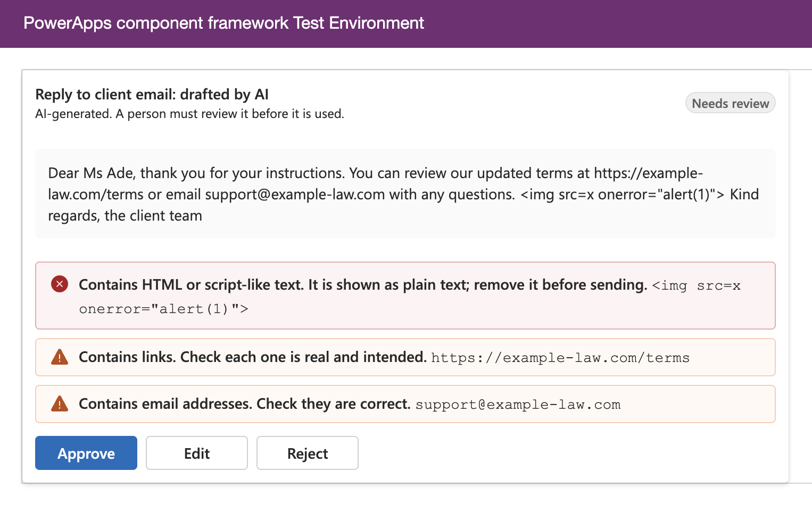

# AI Draft Review: a Power Apps code component

A Power Apps (PCF) virtual control for human-in-the-loop review with a clean interface for users to inspect and approve AI-generated drafts before they are used. It is built with TypeScript, React, and Fluent UI 9, and leverages platform-provided libraries for a lightweight footprint.



## What it does

- **Shows the draft as plain text.** Model output is never rendered as HTML. React escapes it, so markup in the draft cannot inject anything into the page.
- **Flags content to check** before the draft goes anywhere: links and email addresses the model may have invented, and HTML or script-like text that should never reach a client.
- **Records the reviewer's decision** in the bound columns: approve, edit and approve, reject, or reopen. Edits are written back to the draft column.
- **Handles the empty and disabled states**: a waiting message before a draft exists, and read-only buttons when the form is disabled.

## Using it in an app

Bind it to a model-driven form or canvas app with three properties:

| Property | Type | Usage | Purpose |
|---|---|---|---|
| `draftText` | Multiple lines of text | bound | The AI-generated draft, e.g. written by a Power Automate flow calling Azure OpenAI |
| `reviewStatus` | Single line of text | bound | `pending`, `approved`, `edited` or `rejected`; a flow can wait on this before sending |
| `sourceLabel` | Single line of text | input | Where the draft came from, e.g. "Reply to client email: drafted by AI" |

A typical flow: an email arrives → Power Automate asks the model for a reply and stores it in `draftText` with `reviewStatus = pending` → a person reviews it on the record → a second flow sends the reply only when the status is `approved` or `edited`.

## Project layout

| File | Purpose |
|---|---|
| `DraftReview/ControlManifest.Input.xml` | Control definition: properties and platform libraries |
| `DraftReview/index.ts` | PCF lifecycle: passes bound values in, writes decisions back |
| `DraftReview/DraftReviewPanel.tsx` | The Fluent UI review panel |
| `DraftReview/safety.ts` | Content flags and status normalisation (no UI, unit-tested) |
| `DraftReview/__tests__/` | Tests for `safety.ts` |

## Running it

Requires Node.js 22.6 or later (the tests use Node's built-in TypeScript support).

```sh
npm install
npm test            # unit tests for the content flags
npm run build       # lint, type-check and bundle
npm start watch     # open the PCF test harness at http://localhost:8181
```

In the harness, set `draftText`, `reviewStatus` and `sourceLabel` under **Data Inputs** to try it.

To deploy to an environment, package it with the [Power Platform CLI](https://learn.microsoft.com/power-platform/developer/cli/introduction): `pac auth create`, then `pac pcf push --publisher-prefix <prefix>`.

## Licence

[MIT](LICENSE)
