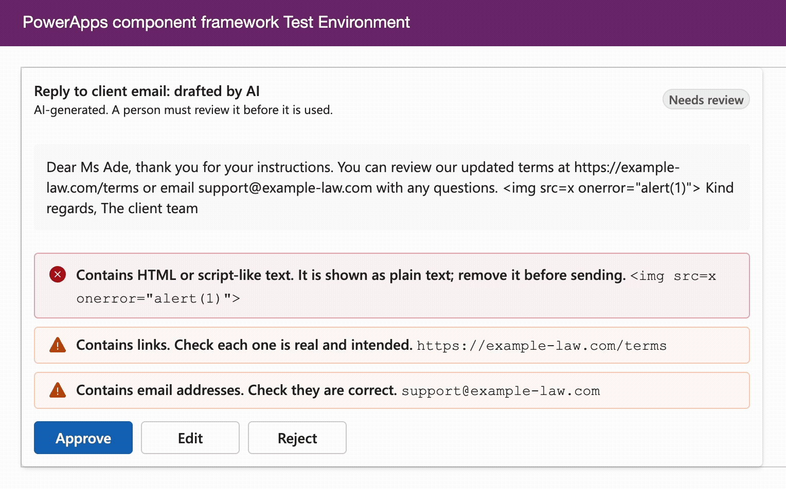

# AI Draft Review: a Power Apps code component

A Power Apps (PCF) control for the step every AI workflow needs: a person checking the AI's draft before it is used. Reviewers see the draft safely as plain text, get warnings about content to check, and approve, edit or reject it on the record.

Works in **model-driven apps** and **canvas apps**. Built with TypeScript, React and Fluent UI 9 as a virtual control, so React and Fluent load from the platform and the bundle stays small.



## What it does

- **Shows the draft as plain text.** Model output is never rendered as HTML. React escapes it, so markup in the draft cannot inject anything into the page.
- **Flags content to check** before the draft goes anywhere: links and email addresses the model may have invented, and HTML or script-like text that should never reach a client.
- **Records the reviewer's decision** in the bound columns. Edits are written back to the draft column.
- **Handles the empty and disabled states**: a waiting message before a draft exists, and read-only buttons when the form is disabled.

The control does not send anything itself. It records the decision, and your own flow acts on it (see [Setting up the flows](#setting-up-the-flows)).

## Properties

| Property | Type | Usage | Purpose |
| --- | --- | --- | --- |
| `draftText` | Multiple lines of text | bound | The AI-generated draft. Reviewer edits are written back here. |
| `reviewStatus` | Single line of text | bound | The decision: `pending`, `approved`, `edited` or `rejected` |
| `sourceLabel` | Single line of text | input | The card title, e.g. "Reply to client email: drafted by AI". Defaults to "AI draft". |

### What each button writes

| Button | `reviewStatus` | `draftText` |
| --- | --- | --- |
| **Approve** | `approved` | unchanged |
| **Edit**, then **Save and approve** | `edited` | the reviewer's edited text |
| **Reject** | `rejected` | unchanged |
| **Reopen** (shown after a decision) | `pending` | unchanged |

Values are always written in lowercase. When reading, the control ignores case and treats an empty or unknown value as `pending` (shown as "Needs review").

## Download

Get the latest solution from the [Releases page](https://github.com/Dhanidayo/pcf-draft-review/releases/latest) and import it in [Power Apps](https://make.powerapps.com) under **Solutions → Import solution**.

| File | Choose it if |
| --- | --- |
| `AIDraftReview_<version>_managed.zip` | You want to use the control. Recommended: it installs and uninstalls cleanly. |
| `AIDraftReview_<version>.zip` | You want to customise the control inside your environment (unmanaged). |

The control is tested in the PCF test harness. If the import or the control does not work in your environment, please [open an issue](https://github.com/Dhanidayo/pcf-draft-review/issues).

**For canvas apps**, an admin must also turn on code components for the environment: in the [Power Platform admin center](https://admin.powerplatform.microsoft.com), open the environment, then go to **Settings → Product → Features** and turn on **Allow publishing of canvas apps with code components**.

## Building from source

You need:

- A Power Platform environment with Dataverse. A free [Power Apps Developer Plan](https://learn.microsoft.com/power-platform/developer/plan) environment works.
- [Node.js](https://nodejs.org) 22.6 or later.
- The [Power Platform CLI](https://learn.microsoft.com/power-platform/developer/cli/introduction) (`pac`). Install it with the Power Platform Tools extension for VS Code, or with `dotnet tool install --global Microsoft.PowerApps.CLI.Tool`.

Then, from the project folder:

```sh
npm install
pac auth create --environment <your environment URL>
pac pcf push --publisher-prefix <prefix>
```

`pac pcf push` builds the control and imports it into your environment in a solution named `PowerAppsTools_<prefix>`.

For canvas apps, turn on code components first, as described under [Download](#download).

## Using it in a model-driven app

1. Create a table for your drafts (for example "Email Draft") with a **Multiple lines of text** column for the draft and a **Single line of text** column for the review status.
2. Open the table's main form in the form designer and select the draft column on the form.
3. In the column's properties, choose **+ Component**. The first time, choose **Get more components** and add **AI Draft Review**.
4. Bind **Draft text** to the draft column and **Review status** to the status column. Type a **Source label**, or bind it to a column.
5. Save and publish the form.

Decisions are saved with the record, like any other change on the form.

## Using it in a canvas app

1. Choose **Insert → Get more components → Code**, then add **AI Draft Review**.
2. Set its properties from your data, for example `draftText` to `ThisItem.'Draft text'` and `reviewStatus` to `ThisItem.'Review status'`.
3. Canvas apps do not save a control's output automatically. Save it in the control's **OnChange** property, for example:

   ```powerfx
   Patch('Email Drafts', ThisItem, {
       'Draft text': DraftReview1.draftText,
       'Review status': DraftReview1.reviewStatus
   })
   ```

## Setting up the flows

A typical setup uses two Power Automate flows around the control.

### Flow 1: draft the reply

1. Trigger: **When a new email arrives (V3)** (Office 365 Outlook). Filter by folder or subject.
2. Generate the reply with **Run a prompt** (AI Builder) or an Azure OpenAI call.
3. **Add a new row** (Dataverse) with the AI's reply in the draft column and `pending` in the status column.

### Flow 2: send once approved

1. Trigger: **When a row is added, modified or deleted** (Dataverse), change type **Modified**, with **Select columns** set to the status column so the flow runs only when the status changes.
2. Condition: the status equals `approved` **or** `edited`.
3. If yes: **Send an email (V2)** using the **draft column**. This sends the reviewer's edited version, not the AI's original.

A reviewer can reopen and approve the same draft again, which triggers Flow 2 a second time. To send each reply only once, add a "Sent on" date column, set it after sending, and add "Sent on is empty" to the condition.

## Limitations

- **The flags guide the reviewer; they are not a security filter.** Only common HTML tags are flagged, so ordinary text like "x < 5" is not. The draft is always shown as plain text, but sanitise anything you send in your flow as well.
- **Light theme only.** The control does not follow dark mode or a custom app theme.
- **English only.** Labels and messages are not localised.

## Developing

```sh
npm install
npm test            # unit tests for the content flags
npm run build       # lint, type-check and bundle
npm start watch     # open the PCF test harness at http://localhost:8181
```

In the harness, set `draftText`, `reviewStatus` and `sourceLabel` under **Data Inputs** to try it.

| File | Purpose |
| --- | --- |
| `DraftReview/ControlManifest.Input.xml` | Control definition: properties and platform libraries |
| `DraftReview/index.ts` | PCF lifecycle: passes bound values in, writes decisions back |
| `DraftReview/DraftReviewPanel.tsx` | The Fluent UI review panel |
| `DraftReview/safety.ts` | Content flags and status normalisation (no UI, unit-tested) |
| `DraftReview/__tests__/` | Tests for `safety.ts` |

## Licence

[MIT](LICENSE)
